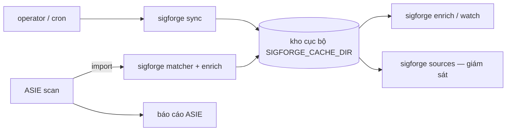
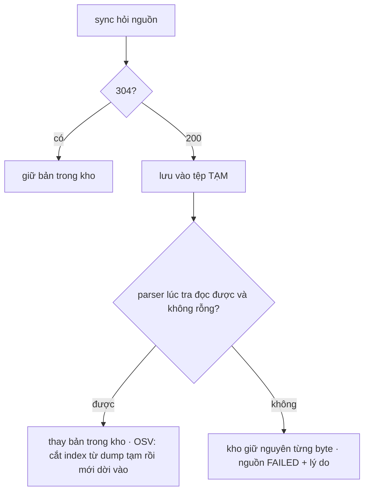
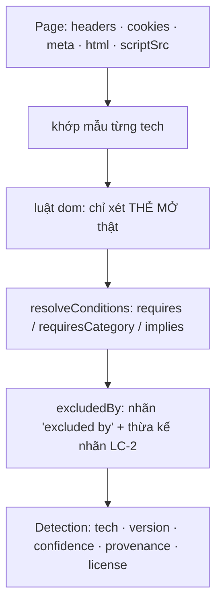
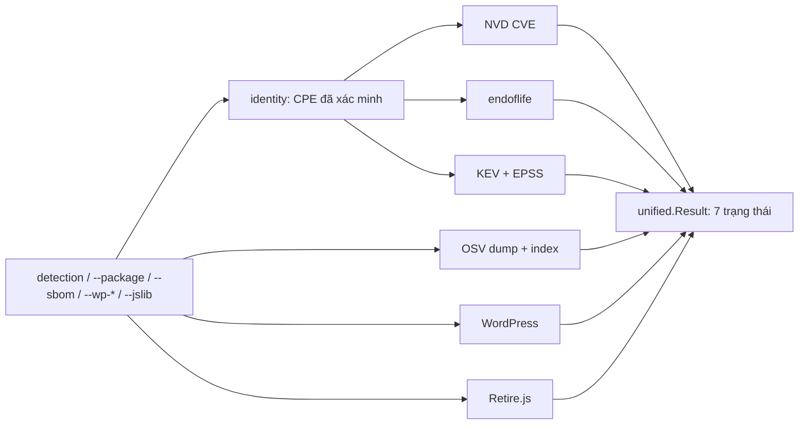
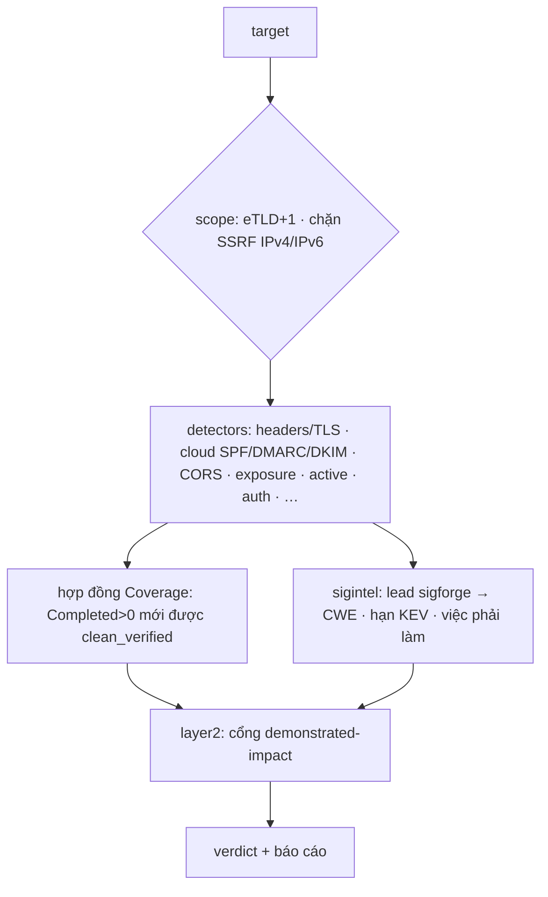

# Luồng mới nhất — sigforge + ASIE · 11/11/2026

**Trạng thái code:**
- sigforge `main` = `5e16e11`.
- ASIE `main` = `3c4ea64`. ASIE dùng sigforge qua `go.mod` pseudo-version `v0.4.1-0.20261111083644-5e16e11515f4`.
- Cả hai chưa có tag mới: sigforge vẫn `v0.4.0`, ASIE vẫn `v0.2.0`.
- Ba phần G01, G10b, G05b của sigforge và toàn bộ phần ASIE đợt 09/11 vào `main` KHÔNG qua soát độc lập. Đó là quyết định của chủ dự án
  ngày 11/11; chúng chỉ có trọng tài và cổng test (mục 8).

## 1. Hai repo ghép với nhau thế nào
- **sigforge** là nền tảng dữ liệu intel, chạy bằng tệp, không có database server. Nó nhận diện công nghệ của trang, rồi gắn CVE / EOL /
  KEV / OSV cho công nghệ và gói phần mềm, với trạng thái trung thực.
- **ASIE** là scanner bảo mật. Nó import sigforge như thư viện để lấy nhận diện và intel, rồi tự chạy detector, suy luận và báo cáo.

## 2. Luồng dùng thật của sigforge (operator)
1. `sync` chạy theo lịch, tải mỗi nguồn đã cấu hình vào kho: endoflife bundle, KEV, Retire.js, từ điển CPE, và các dump OSV khi có
   `--osv <ecosystem>`. Nguồn nào chưa đặt URL qua biến `SIGFORGE_SOURCE_*_URL` thì tắt. Không có nhà cung cấp nào bị hard-code.
2. `enrich` / `watch` đọc kho. Có `SIGFORGE_CACHE_MAX_AGE` thì lượt chạy dùng bản trong kho, 0 request ra ngoài.
3. `sources --max-age D` báo mỗi nguồn: ok / FAILED (lý do) / chưa sync / tắt. Exit 1 khi một nguồn đang dùng bị lỗi hoặc quá cũ.

**Luồng `sync` khi nguồn trả rác** (W3, đã gộp):

- Parser ở đây chính là parser lúc tra, không có parser thứ hai. "Rỗng" (KEV không entry, dump không advisory) cũng bị coi là không dùng
  được.
- **Còn hở (W3b, chưa làm):** `enrich` / `watch` khi tự làm mới một bản đã quá hạn vẫn có thể ghi body rác vào kho. Khi nguồn trả 304
  thì bản trong kho chưa được kiểm lại.

## 3. Luồng nhận diện — matcher

- **Luật `dom` thụ động (G10b):**
  - chỉ xét thẻ mở thật trong trang; bỏ comment;
  - nội dung `<script>` / `<style>` chạy tới đúng thẻ đóng của nó, nên `</scripts>` vẫn là chữ;
  - selector hỏng thì nhánh đó không bao giờ bắn.
  - Dữ liệu thật: golden đúng 42/42; golden sai 190 → 8; hard-negative 8 → 0.
- **Điều kiện (G01):**
  - tech có cổng `requires` / `requiresCategory` chỉ được giữ khi điều kiện thoả;
  - `excludes` KHÔNG hạ cấp hay xoá, chỉ thêm nhãn "excluded by";
  - nhãn được thừa kế qua `requires` khi mọi "carrier" (tech thoả cổng hoặc tech implies) đều mang nhãn — LC-2, chủ dự án chọn;
  - chỉ mục carrier dựng một lần cho mỗi lượt `Match`: trang 6093 tech mất 5,6 ms (bản trước 1,66 s).
- Detection là **lead, không phải bằng chứng**: version lấy từ banner có thể bị giả mạo.

## 4. Luồng intel sâu — enrich

- **Trung thực:** không biết thì là `unknown`, không bao giờ "sạch". "Không khớp" = `not_checked` + note "no clearance". Dòng tổng ghi
  rõ answered / unanswered.
- **OSV:**
  - giữ `limit` của range (G02), không biến thành range mở;
  - floor tất định, không phụ thuộc thứ tự entry (B2);
  - tra theo release dưới floor vẫn giữ lead (G08);
  - định dạng index `/11` nên bản cũ được cắt lại.
- **Một nghĩa "đã trả lời" (G05b):** `Result.Answered` giữ nguyên chữ ký và nghĩa (ASIE dùng); coverage, watch và CLI dùng chung một
  khái niệm theo bảng G05a.

## 5. Luồng `watch` (giám sát lỗ hổng mới)
Mỗi lượt tra inventory, rồi so với state của lượt trước, **từng danh tính riêng**:

| Tình huống của một danh tính | `watch` in | State |
|---|---|---|
| lần đầu có câu trả lời | `FIRST` (lượt đầu toàn cục: một dòng tổng) | ghi lead, đưa vào Seen |
| advisory mới | `NEW` (`--fail-on-new` ⇒ exit 1) | thêm lead |
| advisory không còn, nguồn trả lời ĐỦ | `GONE` | bỏ lead |
| nguồn không trả lời | `UNCHECKED` + lý do | giữ lead cũ |
| dữ liệu nguồn không đủ (WordPress, jslib) | `UNCHECKED` (giữ phần vắng); không bao giờ `GONE` | giữ lead |
| rời inventory | `REMOVED` + số lead | bỏ lead, giữ trong Seen |

Luật cấp lượt:
- không có gì để tra ⇒ lỗi, không ghi state (W1);
- không nguồn nào trả lời ⇒ lỗi, không ghi đè state đã có.

Test mô hình chạy 500 lượt sinh ngẫu nhiên, mỗi lượt 3–5 danh tính dùng chung advisory, so với mô hình viết từ hợp đồng.

## 6. Luồng ASIE (scanner)

- Detector chủ động (Intrusive) chỉ chạy khi `SCANNER_AGGRESSIVE=1`; không bật thì `not_applicable`, 0 request.
- Phần gộp 11/11:
  - redirect giữ trong eTLD+1;
  - thêm 11 dải IPv6 đặc biệt vào bộ chặn SSRF;
  - TLS sâu, chất lượng header bảo mật kèm CSP trong thẻ meta;
  - SPF / DMARC / DKIM, SPF `all` xếp mức theo qualifier;
  - CORS theo endpoint;
  - thêm đường dẫn file lộ, giảm FP;
  - OpenAPI drift, baseline IDOR, phanh load-stress khi gặp 429 / 503 / p95;
  - auth surface thụ động;
  - cổng demonstrated-impact ở layer2.

## 7. Luồng làm việc của dự án (dây chuyền)
spec 5 mục → brief 5 mục (qua `kiem_brief.py`) → worker (worktree riêng, TDD, Q1) → **J** trọng tài → **R / R-Δ** soát độc lập chỉ đọc
→ **M** gộp 3 chiều + cổng theo tên → **A** audit → **C** commit / push khi có lệnh.
- Q1: quét đột biến dòng bản vá thêm.
- Q2: từ 3 điều kiện đan nhau trở lên ⇒ bảng chân trị trước.
- 2 vòng KHONG-DAT cùng lớp ⇒ dừng vá, chủ dự án chọn khuôn.
- Lệnh Go chỉ qua `goslot`: 2 slot, chốt RAM.
- Ngày 11/11 chủ dự án cho gộp bỏ qua bước R với G01 / G10b / G05b và phần ASIE.

## 8. Bằng chứng của phần gộp không qua soát (đều đã chạy)

| Phần | Trọng tài | Cổng sau gộp |
|---|---|---|
| G01 | dựng lại sha; đo xen kẽ trên DB thật; test chặn hiệu năng đỏ trên bản cũ; Q1 115 ⇒ 2 sống tương đương | ⎫ |
| G10b | ca lỗi đỏ trên bản cũ tái tạo; Q1 268 ⇒ 11 sống tương đương | ⎬ sigforge `main`: 1032 pass / 0 fail, mất 0 theo tên; `-race` 25/25 gói |
| G05b | 5 đột biến J tự viết đều đỏ chỉ với test mô hình | ⎭ |
| ASIE đợt 09/11 | mỗi task: test + ít nhất 1 đột biến đỏ | build + vet từng commit; 1673 pass / 0 fail với sigforge `5e16e11` |

## 9. Giới hạn đã biết / việc còn lại
- **F55:** test lý do lỗi của `sync` chỉ so dòng đầu (lỗi nhiều dòng lọt qua). Code đúng.
- **F53:** `matcher.Match` compile regex mỗi lần gọi (~0,3 s trên DB 7695 tech) — phần chậm nhất hiện nay.
- **F56 (mới nghi):** matcher `dom` vẫn đọc thẻ trong `<textarea>` / `<title>`.
- **Chưa làm:**
  - W3b (đường chạy ghi rác vào kho);
  - B1, B3, B4, B5, B8, B11;
  - kiểm cuối A-RC, CHANGELOG, tag `v0.5.0`;
  - với ASIE: kiểm trình duyệt thật cho redirect, perf, EOL profiles, NXDOMAIN takeover.
- Soát độc lập cho phần đã gộp không qua soát: nên làm khi agent chạy lại được (từ 13/11 01:00).
